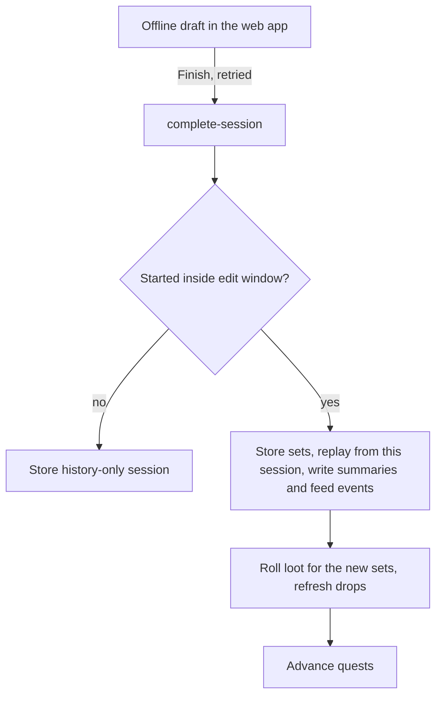

# Game mechanics

Gainscape is a strength-training logger styled after Old School RuneScape (OSRS). Each logged set earns XP in muscle-group skills (Chest, Back, Legs, ...) and cardio skills (Endurance, Agility, Mobility). XP raises levels up to 99 on the OSRS curve. Good sets also set records and drop loot, which you craft into gear that boosts later XP.

The rules live in one pure TypeScript engine, `supabase/functions/_shared/domain/`, shared by the Edge Functions and the web app. Tuning constants live in `balance.ts`. This page names them instead of quoting values, so read that file for current numbers. Skills, exercises, items, drop tables, quests and programs are data in `catalog/*.yaml`.

## From workout to rewards

The server is authoritative. The web app only previews rewards.



1. The web app keeps one local draft per user (`web/src/offline/`). It holds only what you typed and works offline.
2. Finish sends it to `complete-session` and retries through network failures. It stalls after `MAX_CONSECUTIVE_SERVER_FAULTS` server faults in a row or on a wrong account (`finish-retries.ts`). The call is idempotent on the session id, so a retry never doubles rewards.
3. `planNewSession` scores a session only if it started inside the edit window. An older one is stored as history only: no XP, records or loot, so back-dated logs cannot farm rewards.
4. The server replays every session from this one forward (`replayHistory`) and writes their summaries and feed events. Then it rolls loot for the new sets, refreshes drops, and advances quests.

`processSession` in `pipeline.ts` runs each session through fixed steps: resolve sets and effort, track strength, check fatigue, detect records, award XP, add gear and challenge bonuses, apply XP, detect level-ups. Order matters: XP uses the RIR that the strength and fatigue steps settle.

## Effort and reps in reserve

Owning modules: `effort.ts`, `strength.ts`.

Every lift set gets its effort, as reps in reserve (RIR), from one of three sources:

- **Logged:** an effort level (mapped by `effortLevelRir`), a RIR, or an RPE (RIR = 10 − RPE).
- **Estimated:** predicted from the load and your strength estimate.
- **Cold start:** no estimate yet, or the first session with the lift. An unrated set earns a flat `coldStartXpPerSet`, for up to `coldStartMaxSetsPerExercise` sets per built-in exercise per session. These sets have no RIR.

A logged RIR is trusted only so far. If it claims more effort than the estimate minus `rirTrustMargin`, the set is flagged: XP and strength use that trust floor, and the intensity bonus is dropped. Claiming failure on every set gains nothing beyond that margin.

## XP

Owning modules: `xp.ts`, `cardio.ts`, `pipeline.ts`.

Only reps near failure count. Effective reps are the reps inside the last `effectiveRirWindow` + 1 before failure:

```
effective reps = min(reps, max(0, floor(effectiveRirWindow + 1 − RIR)))
set XP         = round(xpPerEffectiveRep × effective reps × intensity bonus)
```

- Warm-ups earn nothing. `xpPerEffectiveRep` is the main pacing lever.
- The intensity bonus rewards heavy sets. It starts once the load passes `intensityBonusStart` of your e1RM and grows with the intensity the rep count implies, up to `intensityBonusMax` at `intensityBonusFull`.
- An exercise's `shares` (basis points summing to 10,000, in `catalog/exercises.yaml`) split its XP across skills. `splitXp` uses largest remainder, so XP stays a whole number and the parts add up.
- Holds and carries become rep equivalents (`holdSecondsPerRep`, `carryMetresPerRep`), take an effort level only, and get no cold start or intensity bonus.
- Cardio earns `cardioXpPerWorkMinute` per counted work minute, scaled by the skill share, `cardioEffortFactor`, `cardioSteadyFactor` for steady bouts, and a pace bonus against the exercise's reference pace (up to `paceBonusMax`; a pace beyond `paceImplausibleRatio` is flagged). Counted minutes per session are capped by `cardioMaxCountedMinutesPerSession`, with a separate `mobilityMaxCountedMinutesPerSession` pool.
- Gear and a passed challenge each add a percentage of the session's base XP per skill. They add up and never compound. Skill XP is capped at `maxXp`.

## Levels

Owning modules: `levels.ts`, `combat.ts`.

Levels follow the OSRS XP table up to `MAX_LEVEL`. The XP per level roughly doubles every `LEVELS_PER_XP_DOUBLING` levels. Total level is the sum of skill levels. Combat level is a weighted average of skill levels, mapped onto the OSRS combat range, with weights from `combat_weight` in `catalog/skills.yaml`.

## Strength and fatigue

Owning modules: `strength.ts`, `fatigue.ts`.

Each lift tracks an estimated one-rep max (e1RM) with the Epley formula on load and reps to failure (reps + RIR). Pure bodyweight lifts track max reps instead.

- Current e1RM is the best estimate from the last `e1rmWindowDays`, else the best from your latest session with that lift.
- Sets beyond `epleyMaxRepsToFailure` reps to failure give no estimate.
- One session raises the estimate by at most `maxStrengthGainPerSession`.
- An estimated RIR raises strength only when the set beats the prediction.

Fatigue lives inside one session. Each hard set lowers expected strength by `fatiguePerHardSet`, scaled by closeness to failure, and later estimates use the lowered value. It also works backwards: if a later set proves an earlier set's RIR was too low (beyond `fatigueToleranceReps`), the earlier RIR is raised and a logged claim is flagged.

## Personal records

Owning modules: `records.ts`, `collection.ts`.

- **Rep maxes:** one slot per rep count up to `REP_MAX_SLOT_COUNT` (`types.ts`). A set fills every slot up to its reps and must beat a slot by `prMinGainKg`.
- **Bodyweight reps**, **cardio** distance, duration and pace, and **hold** duration or carry distance, each with its own minimum gain in `balance.ts`.

The first session with an exercise is a baseline: it fills slots but reports no records. The collection log counts exact rep-max slots filled across the lifts you have done or pinned.

## Loot

Owning modules: `loot.ts`, `rng.ts`, `../loot-seeds.ts`. Constants: `DEFAULT_LOOT`.

- **Regular roll:** needs `minEffectiveReps`, or for cardio `minSteadyCardioWorkS` or `minIntervalCardioWorkS` of work. Capped at `regularRollsPerDay` per local day. The chance starts at `baseChance` and rises by `badLuckStep` per miss up to `maxChance`; a hit resets it. This bad-luck counter carries across days.
- **PR roll:** a qualifying set that sets a record on a built-in exercise also gets a guaranteed rare drop, up to `prRollsPerDay`.

A hit picks a weighted entry from `catalog/drop_tables.yaml` and a quantity in its range. The rare table holds challenge scrolls, pets, Grinder-tier gear and higher-tier scraps.

**Seeding.** Rolls must be reproducible, because replays and edits must never re-roll, and unpredictable, because the code is public. Each seed is an HMAC-SHA256 of `userId:setId:kind` keyed by `LOOT_SECRET`, which only the Edge Functions hold. The digest seeds an sfc32 generator. The same set always gets the same result, but without the secret nobody can compute a roll or search for set ids that hit.

**Revocation.** Edits and deletes can take drops back. A removed set or deleted session always loses its drops. Any replayed set that no longer qualifies loses its drop too. The exception is a set the edit did not change (an unchanged set in the edited session, or any set in a later session): its drop rolled under an older `LOOT_VERSION` or `BALANCE_VERSION` is kept, so rule changes never take loot away.

## Gear and crafting

Owning modules: `gear.ts`, `crafting.ts`; data in `catalog/gear.yaml`.

Gear has slots (`GEAR_SLOTS`) and tiers (`ITEM_TIERS`). Each slot boosts a few skills (`GEAR_SLOT_SKILLS`); Mobility is never boosted. A skill's bonus is `gearBonusPercentAtFullTier` scaled by the average tier of the slots that boost it. Crafting upgrades an item one tier from the previous tier's item plus scraps of the new tier; the catalog generator writes these recipes from `upgrade_scraps`, and the `craft` database function runs them.

`complete-session` snapshots your equipped gear at sync. Replays read the snapshot, so later gear changes never rewrite old XP.

## Challenges and quests

Owning modules: `challenges.ts`, `quests.ts`; data in `catalog/challenges.yaml` and `catalog/quests.yaml`.

A scroll runs one challenge: supersets of reps (optionally at a percentage of e1RM) or a volume target. The scroll is spent at sync, pass or fail, and the server snapshots the definition and your e1RM. The verdict uses only that snapshot and the sets, so replays stay stable. A pass adds `challengeBonusPercent` of base XP.

A quest has required levels and quests, steps (a challenge workout, a volume target, a record, or a number of sessions) and an XP reward. You start one with `start-quest`. A session counts only if it ended after the start, and advances at most one step. Progress moves only when `complete-session` syncs a scored session; edits, deletes and rebuilds never touch it. The reward is an XP grant anchored at a session, re-applied there on every replay.

## Programs

Owning modules: `program-*.ts`, `load-rounding.ts`, `rpe-chart.ts`; templates in `catalog/program-templates/`.

A template (5/3/1, GZCLP, Madcow, ...) is data typed by `ProgramDefinition`. Enrolling binds its lifts to exercises and records starting inputs such as a 1RM or training max.

- **Schedule:** cycles of weeks, plain weeks, or a rotation of days.
- **Prescription:** `resolvePrescription` turns the position and reference weights into sets (percentages, RPE chart, week tables, or relative to another set), rounded to your plate increment and never below the bar on a barbell lift.
- **Progression:** rules judge a lift after a session, week, cycle or wave. A set is met at the prescribed reps and weight, minus half an increment. Rules then increment, hold, reset, deload, step through stages with a 5RM retest, or adjust from AMRAP reps.
- **State:** never stored. `programStateAt` folds the facts (linked sessions, weight changes, skips, jumps) in order, so offline sessions, late syncs and edits agree.

## Replay, edits and the feed

Owning modules: `replay.ts`, `ordering.ts`, `edit-window.ts`, `edit-diff.ts`, `events.ts`.

All derived data is recomputable from logged sets. Sessions replay by start time, then id, and each sees only the history before it. A late sync, an edit or a delete replays everything after it. Sessions can be edited or deleted for `EDIT_WINDOW_DAYS` after they start; history-only sessions never can. A no-op edit writes nothing. After a `BALANCE_VERSION` bump the server refuses stale replays until `make rebuild-caches` runs.

`feedEventsForSession` derives friend-feed events from each summary: level-ups crossing a `levelMilestone` or at `levelAlwaysFrom` and above, level 99, records on built-in exercises, and drops of `dropMinRarity` or rarer. A completed quest posts its own `quest:<key>` event (`questCompletedEvent`). Event keys are stable, so replays keep friends' reactions.

## Where to change things

- A game rule: its `domain/` module. Test with `make test-domain`, then `make test-web`.
- A tuning constant: `balance.ts`, bumping `BALANCE_VERSION` if stored data moves. Run `make test-domain` and `make sim-check`.
- Skills, exercises, items, drops, quests: `catalog/*.yaml`, then `make catalog`. Test with `make test-catalog`.
- A program template: `catalog/program-templates/` (versioned). Run `make test-catalog` and `make test-domain`.
- Sync, replay, loot storage, edits: `supabase/functions/`. Run `make test-integration` (stack).
- SQL functions and policies: a new migration. Run `make test-db` (stack).
- How rewards show on screen: `web/src/lib/**/*-rules.ts`. Run `make test-web`, and `make e2e` for flows.

Before changing a rule, read `supabase/functions/_shared/domain/AGENTS.md` and `catalog/AGENTS.md`. They list the invariants that silently change existing players' data.

## Glossary

- **e1RM:** estimated one-rep max.
- **Effective reps:** reps near enough to failure to earn XP.
- **Flagged set:** a set whose logged effort the engine did not believe.
- **History-only session:** stored for the record, with no rewards.
- **RIR / RPE:** reps in reserve; rate of perceived exertion.
- **Scroll:** a rare drop that unlocks one challenge run.
